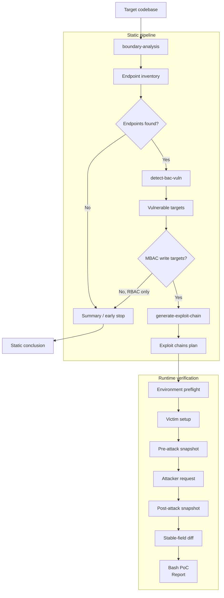
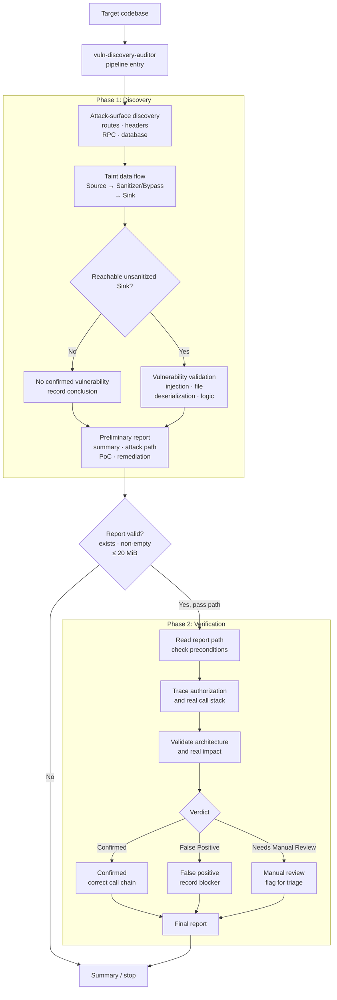

# SecAdA

[English](README.md) | [简体中文](README.zh-CN.md)

This project contains code-audit agent systems implemented with LangChain. The systems are divided by detection target into two independently runnable, composable parts:

- **Broken Access Control (BAC) detection system**: follows the flow "endpoint inventory -> vulnerable targets -> exploit chains -> runtime evidence" and covers IDOR, BFLA, and read/write access-control flaws.
- **Taint-style vulnerability audit system**: follows the flow "attack-surface discovery -> Source/Sanitizer/Sink data flow -> preliminary report -> false-positive verification" and targets taint-style vulnerabilities such as injection, file operations, deserialization, and front-end injection.

Both systems use Deep Agents' `SkillsMiddleware` to load their packaged skills. The initial system prompt contains only runtime context and security constraints. The middleware exposes skill names, descriptions, and virtual paths to the model, which then uses the read-only `read_file` tool to load the complete `SKILL.md`, examples, and reference materials on demand. This progressive-disclosure approach avoids preloading all skill content on every model call.

## Pipeline Entry Points

Both systems provide a single pipeline entry point, so internal agents do not need to be run manually in sequence:

```bash
uv run python -m agents.bac_static_pipeline /absolute/path/to/target-project
uv run python -m agents.vuln_discovery_auditor /absolute/path/to/target-project
```

- `bac_static_pipeline`: runs boundary analysis, BAC vulnerability detection, and exploit-chain planning in order, and stops early when endpoint or vulnerability gates are not satisfied.
- `vuln_discovery_auditor`: runs taint vulnerability discovery and generates a preliminary report. After the report passes its gate, it is automatically passed to `vuln-report-verifier` for review.

## 1. Broken Access Control (BAC) Detection System

This system consists of three static-analysis agents, a LangGraph orchestration entry point, and an optional runtime verification agent. The static stages produce structured analysis artifacts from source code only and do not send real requests. The runtime verification stage reads those artifacts, reproduces exploit chains with victim and attacker identities, and outputs differential evidence.

- `boundary-analysis`: replicates the Codex skill's boundary-analysis workflow. It identifies the technology stack, collects Web/API routes, traces DTOs/Entities and validation constraints, and generates a normalized `Endpoint_Inventory` for downstream audits. This stage does not make vulnerability judgments.
- `detect-bac-vuln`: replicates the Codex skill's access-control vulnerability detection workflow. It reads the phase-one `Endpoint_Inventory`, combines project source code and expert knowledge to infer IDOR/BFLA targets, and writes a structured `Vulnerable_Targets_Map`.
- `generate-exploit-chain`: replicates the Codex skill's exploit-chain planning workflow. It reads the vulnerable-target map and the full endpoint inventory, then generates a strict four-step victim/attacker differential plan `Exploit_Chains_Plan` for targets with satisfiable preconditions. This phase only produces JSON plans and does not send real HTTP requests.
- `bac-static-pipeline`: uses LangGraph to orchestrate the three static-analysis phases, explicitly passes artifacts between phases, stops at gates when there are no endpoints, no vulnerabilities, or only read-only vulnerability candidates, and outputs a unified summary.
- `exec-diff-oracle`: replicates the Codex skill's runtime verification workflow. It executes exploit-chain plans, records attack responses, pre/post snapshots of stable fields, and diffs, and generates a rerunnable Bash PoC and Typst report for each chain. This phase requires explicit test-environment URLs and identity credentials.

The BAC system workflow is shown below:



When run through `bac-static-pipeline`, artifacts are written to the central directory of the current SecAdA repository and isolated by target-project name:

```text
output/<project-name>/Endpoint_Inventory_<timestamp>.json
output/<project-name>/Vulnerable_Targets_Map_<timestamp>.json
output/<project-name>/Exploit_Chains_Plan_<timestamp>.json
```

The three standalone static phases still write to the target project's `vuln_scan/` by default and can be redirected with their own `--output-directory` option. The pipeline can override the central output root with `--output-root`. Runtime verification artifacts from `exec-diff-oracle` continue to follow that agent's own output configuration. The default manifest is `vuln_scan/Exec_Diff_Oracle_Manifest_<timestamp>.json`, and each exploit chain produces a paired Bash PoC and Typst report.

### Running the BAC Static Pipeline

```bash
uv run python -m agents.bac_static_pipeline /absolute/path/to/target-project \
  --scope-hints "orders,admin APIs"
```

To debug an individual phase, you can also run the agents separately:

```bash
uv run python -m agents.boundary_analysis /absolute/path/to/target-project
uv run python -m agents.detect_bac_vuln /absolute/path/to/target-project
uv run python -m agents.generate_exploit_chain /absolute/path/to/target-project
uv run python -m agents.exec_diff_oracle /absolute/path/to/target-project \
  --base-url http://127.0.0.1:8000 \
  --victim-token victim-token \
  --attacker-token attacker-token
```

Available options:

```bash
uv run python -m agents.boundary_analysis --help
uv run python -m agents.detect_bac_vuln --help
uv run python -m agents.generate_exploit_chain --help
uv run python -m agents.bac_static_pipeline --help
uv run python -m agents.exec_diff_oracle --help
```

## 2. Taint-Style Vulnerability Audit System

This system consists of two agents connected through the `vuln-discovery-auditor` unified entry point. In phase one, `vuln-discovery-auditor` performs white-box attack-surface discovery, taint tracking, and vulnerability-type validation, then produces a preliminary report. After a gate confirms that the report exists, is non-empty, and does not exceed the review size limit, the pipeline automatically passes its path to phase two, `vuln-report-verifier`. The verifier reads the preliminary report and target source code from an adversarial perspective, focusing on disproving false positives caused by impossible preconditions, missed global authorization checks, or incorrect assumptions about architectural impact.

- `vuln-discovery-auditor`: replicates the Codex skill's white-box vulnerability discovery workflow. It first identifies Sources, Sanitizers, and Sinks, then traces the Source -> Sanitizer/Bypass -> Sink data flow, and outputs a preliminary Markdown report with code evidence, concept PoCs, and remediation code comparisons.
- `vuln-report-verifier`: replicates the Codex skill's vulnerability-report verification workflow. It reviews preliminary conclusions from three perspectives: business preconditions, the global authorization call stack, and architectural impact, then outputs a verification report with a `Confirmed`, `False Positive`, or `Needs Manual Review` verdict.

The taint-style vulnerability audit system workflow is shown below:



By default, the pipeline writes the preliminary report to the target project's `vuln_scan/Security_Audit_Report_<timestamp>.md` and the verification report to `vuln_scan/Security_Verification_Report_<timestamp>.md`. Both phases share the same output directory. The path of the phase-one report is passed automatically to phase two, so there is no need to copy it or enter it manually.

### Running the Taint Audit Pipeline

```bash
uv run python -m agents.vuln_discovery_auditor /absolute/path/to/target-project
uv run python -m agents.vuln_discovery_auditor /absolute/path/to/target-project \
  --output-directory /absolute/path/to/audit-output \
  --instruction "Focus on SQL injection and deserialization" \
  --verification-instruction "Focus on global authorization middleware"
```

Run only phase one and skip report verification:

```bash
uv run python -m agents.vuln_discovery_auditor /absolute/path/to/target-project \
  --audit-only
```

To re-verify an existing report independently, you can still run `vuln-report-verifier` directly:

```bash
uv run python -m agents.vuln_report_verifier /absolute/path/to/target-project \
  /absolute/path/to/target-project/vuln_scan/Security_Audit_Report_<timestamp>.md
```

Available options:

```bash
uv run python -m agents.vuln_discovery_auditor --help
uv run python -m agents.vuln_report_verifier --help
```

## Environment Configuration

Configure an OpenAI-compatible endpoint in the `.env` file at the project root:

```dotenv
CUSTOM_LLM_MODEL_NAME=your-model
CUSTOM_LLM_API_KEY=your-key
CUSTOM_LLM_BASE_URL=https://your-provider.example/v1
```

## Programmatic Usage

```python
from agents.boundary_analysis import create_boundary_analysis_agent
from agents.bac_static_pipeline import create_bac_static_pipeline
from agents.detect_bac_vuln import create_detect_bac_vulnerability_agent
from agents.generate_exploit_chain import create_generate_exploit_chain_agent
from agents.exec_diff_oracle import create_exec_diff_oracle_agent
from agents.vuln_discovery_auditor import (
    create_taint_audit_pipeline,
    create_vulnerability_discovery_agent,
)
from agents.vuln_report_verifier import create_vulnerability_report_verifier_agent

agent = create_boundary_analysis_agent("/path/to/target-project")
result = agent.invoke()
print(result.output_path)

bac_agent = create_detect_bac_vulnerability_agent("/path/to/target-project")
bac_result = bac_agent.invoke()
print(bac_result.output_path)

chain_agent = create_generate_exploit_chain_agent("/path/to/target-project")
chain_result = chain_agent.invoke()
print(chain_result.output_path)

pipeline_result = create_bac_static_pipeline("/path/to/target-project").invoke()
print(pipeline_result.output_directory)
print(pipeline_result.state["summary"])

oracle_agent = create_exec_diff_oracle_agent(
    "/path/to/target-project",
    {
        "base_url": "http://127.0.0.1:8000",
        "victim_token": "victim-token",
        "attacker_token": "attacker-token",
    },
)
oracle_result = oracle_agent.invoke()
print(oracle_result.manifest_path)

taint_pipeline_result = create_taint_audit_pipeline(
    "/path/to/target-project",
).invoke(
    audit_instruction="Focus on SQL injection and deserialization",
    verification_instruction="Focus on global authorization middleware",
)
print(taint_pipeline_result.audit_report_path)
print(taint_pipeline_result.verification_report_path)

audit_agent = create_vulnerability_discovery_agent("/path/to/target-project")
audit_result = audit_agent.invoke()
print(audit_result.output_path)

verifier_agent = create_vulnerability_report_verifier_agent(
    "/path/to/target-project",
    audit_result.output_path,
)
verification_result = verifier_agent.invoke()
print(verification_result.output_path)
```

You can also inject any tool-calling-capable LangChain `BaseChatModel` into `create_boundary_analysis_agent(..., model=your_chat_model)` for testing or switching model providers.

## Project Structure

- `agents/skill_middleware.py`: shared `SkillsMiddleware`, read-only file middleware, and normalized virtual skill path configuration.
- `agents/bac_static_pipeline/`: LangGraph state machine, stage gates, and unified summary for the BAC static detection pipeline.
- `agents/vuln_discovery_auditor/pipeline.py`: LangGraph state machine, report gate, path handoff, and unified summary for taint discovery through report verification.
- `agents/boundary_analysis/`, `agents/detect_bac_vuln/`, `agents/generate_exploit_chain/`, `agents/exec_diff_oracle/`: static-analysis and runtime-verification agents for the BAC detection system.
- `agents/vuln_discovery_auditor/`, `agents/vuln_report_verifier/`: preliminary-discovery and report-verification agents for the taint-style vulnerability audit system.
- Each agent directory contains `agent.py`, `cli.py`, `schemas.py`, `tools.py`, `skill.py`, and `skill/`. The middleware progressively loads `SKILL.md`, extraction guides, methodologies, output examples, and report templates from the skill directory instead of embedding them in the system prompt.
- `output/<project-name>/`: central static-analysis artifact directory for `bac-static-pipeline`.

Run unit tests:

```bash
uv run python -m unittest discover -v
```
