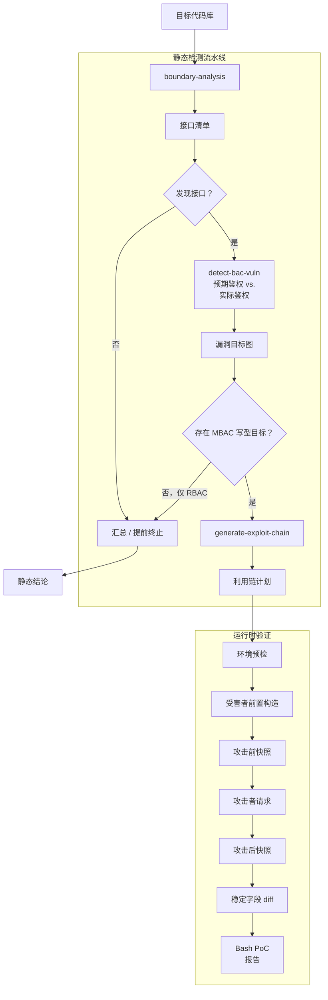
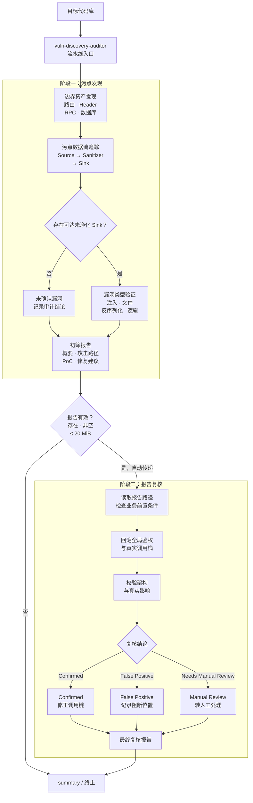

# SecAdA

[English](README.md) | 简体中文

本项目包含使用 LangChain 实现的代码审计 agent 系统，按检测目标分为两个可独立运行、也可组合使用的部分：

- **访问控制漏洞（BAC）检测系统**：围绕“接口清单 -> 漏洞目标 -> 利用链 -> 运行时证据”展开，覆盖 IDOR、BFLA 以及读写型访问控制缺陷。
- **污点型漏洞审计系统**：围绕“攻击面发现 -> Source/Sanitizer/Sink 数据流 -> 初筛报告 -> 误报复核”展开，面向注入、文件操作、反序列化、前端注入等污点型漏洞。

两个系统均通过 Deep Agents 的 `SkillsMiddleware` 加载各自的打包 skill。初始化 system prompt 只包含运行上下文与安全约束；中间件向模型披露 skill 的名称、描述和虚拟路径，模型再通过只读 `read_file` 按需加载完整 `SKILL.md`、示例和参考资料。这种渐进披露方式避免在每次模型调用中预先拼接完整 skill 内容。

## 流水线入口

两个系统均提供统一流水线入口，无需依次手动运行内部 agent：

```bash
uv run python -m agents.bac_static_pipeline /absolute/path/to/target-project
uv run python -m agents.vuln_discovery_auditor /absolute/path/to/target-project
```

- `bac_static_pipeline`：依次执行边界分析、BAC 漏洞识别和利用链规划，并在接口或漏洞门控不满足时提前终止。
- `vuln_discovery_auditor`：先执行污点漏洞发现并生成初筛报告，报告通过门控后自动传给 `vuln-report-verifier` 完成复核。

## 一、访问控制漏洞（BAC）检测系统

该系统由三个静态分析 agent、一个 LangGraph 编排入口和一个可选的运行时验证 agent 组成。静态阶段只基于源码生成结构化分析产物，不执行真实请求；运行时验证阶段读取静态产物，使用受害者与攻击者两类身份复现越权链并输出差分证据。

- `boundary-analysis`：复刻 Codex skill 的边界分析流程，识别技术栈、搜集 Web/API 路由、追踪 DTO/Entity 及验证约束，并生成供后续审计使用的规范化 `Endpoint_Inventory`。本阶段不会判断漏洞。
- `detect-bac-vuln`：复刻 Codex skill 的访问控制漏洞识别流程，读取阶段一的 `Endpoint_Inventory`，结合项目源码和专家知识库推断 IDOR/BFLA 目标，并写入结构化 `Vulnerable_Targets_Map`。
- `generate-exploit-chain`：复刻 Codex skill 的利用链规划流程，读取漏洞目标图和完整端点清单，为可满足前置依赖的目标生成严格四步的受害者/攻击者差分计划 `Exploit_Chains_Plan`。该阶段只生成 JSON 计划，不执行真实 HTTP 请求。
- `bac-static-pipeline`：使用 LangGraph 编排以上三个静态分析阶段，显式传递阶段产物，在无接口、无漏洞或只有只读漏洞候选时按门控条件终止，并输出统一汇总。
- `exec-diff-oracle`：复刻 Codex skill 的运行时验证流程，严格执行利用链计划，记录攻击响应、前后稳定字段快照和 diff，并为每条链生成可重跑 Bash PoC 与 Typst 报告。该阶段需要显式提供测试环境地址和身份凭证。

BAC 系统工作流如下：



通过 `bac-static-pipeline` 运行时，产物统一写入当前 SecAdA 项目的中央目录，并按目标项目名称隔离：

```text
output/<project-name>/Endpoint_Inventory_<timestamp>.json
output/<project-name>/Vulnerable_Targets_Map_<timestamp>.json
output/<project-name>/Exploit_Chains_Plan_<timestamp>.json
```

三个独立静态阶段默认仍写入目标项目的 `vuln_scan/`，也可以通过各自的 `--output-directory` 参数改为指定目录；流水线可以通过 `--output-root` 覆盖中央输出根目录。`exec-diff-oracle` 的运行时验证产物仍遵循该 agent 自身的输出配置，默认清单为 `vuln_scan/Exec_Diff_Oracle_Manifest_<timestamp>.json`，并为每条利用链生成成对的 Bash PoC 与 Typst 报告。

### 运行 BAC 静态流水线

```bash
uv run python -m agents.bac_static_pipeline /absolute/path/to/target-project \
  --scope-hints "orders,admin APIs"
```

如需单独调试某个阶段，也可以分别运行：

```bash
uv run python -m agents.boundary_analysis /absolute/path/to/target-project
uv run python -m agents.detect_bac_vuln /absolute/path/to/target-project
uv run python -m agents.generate_exploit_chain /absolute/path/to/target-project
uv run python -m agents.exec_diff_oracle /absolute/path/to/target-project \
  --base-url http://127.0.0.1:8000 \
  --victim-token victim-token \
  --attacker-token attacker-token
```

可用参数：

```bash
uv run python -m agents.boundary_analysis --help
uv run python -m agents.detect_bac_vuln --help
uv run python -m agents.generate_exploit_chain --help
uv run python -m agents.bac_static_pipeline --help
uv run python -m agents.exec_diff_oracle --help
```

## 二、污点型漏洞审计系统

该系统由两个 agent 组成，并通过 `vuln-discovery-auditor` 这个统一入口串联。阶段一的 `vuln-discovery-auditor` 以白盒方式执行攻击面发现、污点追踪和漏洞类型验证，产出初筛报告；门控节点确认报告存在、非空且未超过复核大小限制后，流水线自动把报告路径传给阶段二的 `vuln-report-verifier`。`vuln-report-verifier` 以对抗性视角读取初筛报告和目标源码，重点证伪由前置条件不成立、全局鉴权遗漏或架构影响误判导致的误报。

- `vuln-discovery-auditor`：复刻 Codex skill 的白盒漏洞发现流程，先识别 Source、Sanitizer 和 Sink，再追踪 Source -> Sanitizer/Bypass -> Sink 数据流，并输出带代码证据、概念 PoC 和修复代码对比的初筛 Markdown 报告。
- `vuln-report-verifier`：复刻 Codex skill 的漏洞报告复核流程，从业务前置条件、全局鉴权调用栈和架构影响三个层面审查初筛结论，输出带 `Confirmed`、`False Positive` 或 `Needs Manual Review` verdict 的复核报告。

污点型漏洞审计系统工作流如下：



流水线默认将初筛报告写入目标项目的 `vuln_scan/Security_Audit_Report_<timestamp>.md`，复核报告写入 `vuln_scan/Security_Verification_Report_<timestamp>.md`。两个阶段使用同一个输出目录，阶段一生成的报告路径会由流水线自动传给阶段二，无需手工复制或填写报告路径。

### 运行污点审计流水线

```bash
uv run python -m agents.vuln_discovery_auditor /absolute/path/to/target-project
uv run python -m agents.vuln_discovery_auditor /absolute/path/to/target-project \
  --output-directory /absolute/path/to/audit-output \
  --instruction "重点关注 SQL 注入与反序列化" \
  --verification-instruction "重点检查全局鉴权中间件"
```

只运行阶段一、跳过报告复核：

```bash
uv run python -m agents.vuln_discovery_auditor /absolute/path/to/target-project \
  --audit-only
```

如需单独重新复核已有报告，仍可直接运行 `vuln-report-verifier`：

```bash
uv run python -m agents.vuln_report_verifier /absolute/path/to/target-project \
  /absolute/path/to/target-project/vuln_scan/Security_Audit_Report_<timestamp>.md
```

可用参数：

```bash
uv run python -m agents.vuln_discovery_auditor --help
uv run python -m agents.vuln_report_verifier --help
```

## 环境配置

在项目根目录的 `.env` 中配置 OpenAI 兼容接口：

```dotenv
CUSTOM_LLM_MODEL_NAME=your-model
CUSTOM_LLM_API_KEY=your-key
CUSTOM_LLM_BASE_URL=https://your-provider.example/v1
```

## 代码调用

```python
from agents.boundary_analysis import create_boundary_analysis_agent
from agents.bac_static_pipeline import create_bac_static_pipeline
from agents.detect_bac_vuln import create_detect_bac_vulnerability_agent
from agents.generate_exploit_chain import create_generate_exploit_chain_agent
from agents.exec_diff_oracle import create_exec_diff_oracle_agent
from agents.vuln_discovery_auditor import (
    create_taint_audit_pipeline,
    create_vulnerability_discovery_agent,
)
from agents.vuln_report_verifier import create_vulnerability_report_verifier_agent

agent = create_boundary_analysis_agent("/path/to/target-project")
result = agent.invoke()
print(result.output_path)

bac_agent = create_detect_bac_vulnerability_agent("/path/to/target-project")
bac_result = bac_agent.invoke()
print(bac_result.output_path)

chain_agent = create_generate_exploit_chain_agent("/path/to/target-project")
chain_result = chain_agent.invoke()
print(chain_result.output_path)

pipeline_result = create_bac_static_pipeline("/path/to/target-project").invoke()
print(pipeline_result.output_directory)
print(pipeline_result.state["summary"])

oracle_agent = create_exec_diff_oracle_agent(
    "/path/to/target-project",
    {
        "base_url": "http://127.0.0.1:8000",
        "victim_token": "victim-token",
        "attacker_token": "attacker-token",
    },
)
oracle_result = oracle_agent.invoke()
print(oracle_result.manifest_path)

taint_pipeline_result = create_taint_audit_pipeline(
    "/path/to/target-project",
).invoke(
    audit_instruction="重点关注 SQL 注入与反序列化",
    verification_instruction="重点检查全局鉴权中间件",
)
print(taint_pipeline_result.audit_report_path)
print(taint_pipeline_result.verification_report_path)

audit_agent = create_vulnerability_discovery_agent("/path/to/target-project")
audit_result = audit_agent.invoke()
print(audit_result.output_path)

verifier_agent = create_vulnerability_report_verifier_agent(
    "/path/to/target-project",
    audit_result.output_path,
)
verification_result = verifier_agent.invoke()
print(verification_result.output_path)
```

也可以向 `create_boundary_analysis_agent(..., model=your_chat_model)` 注入任意支持 tool calling 的 LangChain `BaseChatModel`，用于测试或切换模型供应商。

## 组成

- `agents/skill_middleware.py`：共享的 `SkillsMiddleware`、只读文件 middleware 和规范化虚拟 skill 路径配置。
- `agents/bac_static_pipeline/`：BAC 静态检测流水线的 LangGraph 状态机、阶段门控和统一汇总。
- `agents/vuln_discovery_auditor/pipeline.py`：污点发现到报告复核的 LangGraph 状态机、报告门控、路径传递和统一汇总。
- `agents/boundary_analysis/`、`agents/detect_bac_vuln/`、`agents/generate_exploit_chain/`、`agents/exec_diff_oracle/`：BAC 检测系统的静态分析与运行时验证 agent。
- `agents/vuln_discovery_auditor/`、`agents/vuln_report_verifier/`：污点型漏洞审计系统的初筛发现与报告复核 agent。
- 每个 agent 目录独立包含 `agent.py`、`cli.py`、`schemas.py`、`tools.py`、`skill.py` 和 `skill/`；skill 中的 `SKILL.md`、提取指南、方法论、输出示例和报告模板由 middleware 渐进加载，不直接拼入 system prompt。
- `output/<project-name>/`：`bac-static-pipeline` 的中央静态分析产物目录。

运行单元测试：

```bash
uv run python -m unittest discover -v
```
